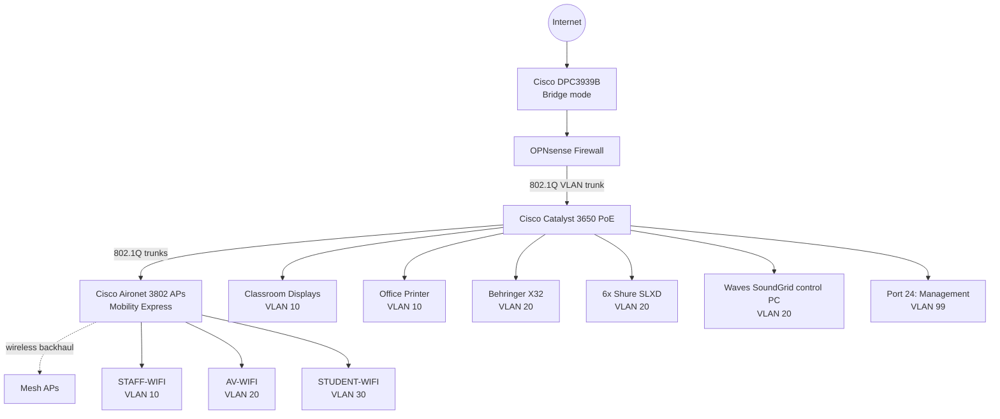

# Academia-Network
Segmented VLAN network design and deployment for a music school: staff, student, and AV networks with firewall policy and documentation Network deployment case study: VLAN segmentation, firewall rules, and Wi-Fi design for a small music school Designed and installed a 4-VLAN network (staff, students, AV, management) for a music school
# Segmented Network Deployment: OPNsense, Cisco Catalyst 3650 & Mobility Express

> A four-VLAN network that isolates students from staff, AV, and management, built on an OPNsense firewall, a Cisco Catalyst 3650 PoE switch, and Cisco Aironet 3802 access points running Mobility Express.

*IP ranges and port numbers are examples or sanitized. No credentials or identifying information are included.*

## Table of Contents
- [Overview](#overview)
- [Objectives](#objectives)
- [Infrastructure](#infrastructure)
- [Topology](#topology)
- [VLAN & IP Addressing](#vlan--ip-addressing)
- [Management Network](#management-network)
- [Device Placement](#device-placement)
- [Wireless Design](#wireless-design)
- [Firewall & Security Policy](#firewall--security-policy)
- [Cisco Catalyst 3650 Configuration](#cisco-catalyst-3650-configuration)
- [OPNsense Configuration](#opnsense-configuration)
- [Mobility Express Configuration](#mobility-express-configuration)
- [AV Network Considerations](#av-network-considerations)
- [Management & Maintenance](#management--maintenance)
- [Skills Demonstrated](#skills-demonstrated)

## Overview
This project deploys a segmented network using a Cisco Catalyst 3650 PoE switch, Cisco Aironet 3802 access points running Mobility Express, and an OPNsense firewall/router.

The primary goal is to **isolate the student network from staff, AV, and management**, while letting staff and AV devices reach the services they need and giving every network internet access where permitted.

The network uses four VLANs (staff, AV, student, and management) and three wireless SSIDs. OPNsense handles routing, DHCP, DNS, and firewall enforcement. The Catalyst 3650 provides switching and PoE. The 3802 APs provide wireless connectivity through Mobility Express.

## Objectives
- Isolate students from staff, AV, and network management
- Provide internet access to the staff, AV, and student VLANs
- Keep classroom displays and the office printer on the STAFF VLAN
- Keep the Behringer X32, six Shure SLXD units, and the Waves SoundGrid control PC on the AV VLAN
- Let the AV VLAN reach the STAFF VLAN, including the printer and classroom displays, and nothing else internal
- Put network management on a dedicated VLAN, reachable through a physical management port on the switch
- Provide three dedicated wireless SSIDs with different QoS priority and bandwidth
- Enforce inter-VLAN access restrictions through OPNsense
- Centralize wireless management with Cisco Mobility Express

## Infrastructure

| Device | Role |
|---|---|
| OPNsense (HP ProDesk, 10th-gen Core i3, 8 GB RAM) | Firewall, router, DHCP, DNS, and VLAN gateway |
| LR-LINK LRES3004PT (4-port PCIe, Intel i210) | Network interfaces for OPNsense (WAN and VLAN trunk) |
| Cisco DPC3939B | ISP modem in bridge mode |
| Cisco Catalyst 3650 PoE | Managed switch: VLAN switching and PoE |
| Cisco Aironet 3802 | Wireless access points |
| Mobility Express | Wireless controller management |
| Behringer X32 | Digital audio console |
| Shure SLXD receivers (x6) | Wireless microphone receivers |
| Waves SoundGrid control PC | Remote control of the SoundGrid audio system |
| Classroom displays | Classroom display equipment |
| Office printer | Office printing |

## Topology



## VLAN & IP Addressing

| VLAN ID | Name | Subnet | Gateway | DHCP |
|---|---|---|---|---|
| 10 | STAFF | 192.168.10.0/24 | 192.168.10.1 | OPNsense |
| 20 | AV | 192.168.20.0/24 | 192.168.20.1 | OPNsense |
| 30 | STUDENT | 192.168.30.0/24 | 192.168.30.1 | OPNsense |
| 99 | MANAGEMENT | 192.168.99.0/24 | 192.168.99.1 | OPNsense (small scope) |

| VLAN | Purpose | Devices |
|---|---|---|
| **10 - STAFF** | Staff computers, classroom displays, office printer, approved administrative devices | Staff computers and laptops, classroom displays, office printer, staff wireless devices |
| **20 - AV** | Dedicated network for audio and AV equipment | Behringer X32, six Shure SLXD receivers, Waves SoundGrid control PC, AV control equipment, approved AV wireless devices |
| **30 - STUDENT** | Student internet access with no access to internal infrastructure | Student laptops, tablets, phones, wireless clients |
| **99 - MANAGEMENT** | Administration of the network infrastructure | Switch, AP/Mobility Express, and OPNsense management; admin workstation on switch port 24 |

## Management Network

Network management lives on its own VLAN (**VLAN 99**), separate from the user networks.

- **Management port:** switch port 24 (`GigabitEthernet1/0/24`) is an access port on VLAN 99. An administrator plugs in a workstation here to manage the network.
- **Switch management:** the 3650 has an IP address on VLAN 99 (192.168.99.2) with OPNsense (192.168.99.1) as its gateway.
- **OPNsense:** a MANAGEMENT interface on the VLAN 99 trunk. The OPNsense web GUI and SSH are restricted to this interface.
- **Mobility Express / APs:** the APs and the Mobility Express controller are on VLAN 99. It is carried as the untagged (native) VLAN on the AP trunk ports, while the SSID VLANs (10, 20, 30) are tagged. VLAN 1 is not used.
- **Access policy:** devices on VLAN 99 can reach all VLANs and the infrastructure. No other VLAN can initiate connections into VLAN 99.
- **Addressing:** infrastructure devices (switch, APs, the Mobility Express controller) use static addresses or reservations in the .2-.99 range, outside the DHCP scope. The DHCP scope (.100-.110) covers only the admin workstation.

### Native VLAN Design Note
Best practice is normally to set the native VLAN on trunks to an unused "blackhole" VLAN and to tag the management VLAN. This deployment does not use a blackhole VLAN. On the AP trunks, **VLAN 99 (management) is the native VLAN**, because the Mobility Express controller and the APs' management and CAPWAP traffic are carried **untagged** on the wire. The client VLANs (10, 20, 30) remain tagged.

**Does this make VLAN 99 unsafe?** No. A native VLAN is not an unprotected VLAN. The security of VLAN 99 depends on what is permitted into and out of it, not on whether it is native. The design is hardened as follows:
- VLAN 99 access is limited to the dedicated administrator workstation and trusted infrastructure
- STAFF, AV, and STUDENT cannot initiate connections to management interfaces
- Management services (SSH, HTTPS, SNMP) are restricted to authorized sources [e.g. an access list on the switch VTY lines]
- VLAN 99 is not assigned to any student, staff, or AV access port. The only access port in VLAN 99 is the physically controlled management port (port 24)
- OPNsense firewall rules restrict access to management IP addresses
- Unused switch ports are disabled
- Management interfaces are not exposed to the WAN

The classic native-VLAN risk is VLAN hopping by double tagging, which requires an attacker on an access port in the native VLAN. Keeping every untrusted port out of VLAN 99 closes that path.

## Device Placement

| Device | VLAN | Network |
|---|---|---|
| Classroom displays | 10 | STAFF |
| Office printer | 10 | STAFF |
| Staff devices | 10 | STAFF |
| Behringer X32 | 20 | AV |
| Shure SLXD receivers 1-6 | 20 | AV |
| Waves SoundGrid control PC | 20 | AV |
| Student devices | 30 | STUDENT |
| Admin workstation (switch port 24) | 99 | MANAGEMENT |
| Switch, OPNsense, AP management | 99 | MANAGEMENT |

Devices are assigned to their VLAN through switch access ports, wireless SSID assignment, or approved network configurations.

## Wireless Design

Wireless has two separate parts: the **controller** (how the APs are managed) and the **mesh** (how the APs connect to the network).

### Controller: Cisco Mobility Express
Mobility Express runs the wireless controller function inside one of the Aironet 3802 APs, and the other APs join it as subordinate APs. It handles management and policy: SSIDs, SSID-to-VLAN mapping, QoS, bandwidth limits, RF management, and roaming. This avoided buying a dedicated wireless controller.

### Mesh: how APs reach the wired network
- **Root APs (RAPs)** are wired to the Catalyst 3650 over PoE, including the AP running the controller.
- **Mesh APs (MAPs)** have no cable drop and connect to a root AP over a wireless backhaul.
- Mesh support in Mobility Express was introduced in release 8.10, and the 3802 is supported as both a root AP and a mesh AP. Mesh APs run in Flex+Bridge mode. [Confirm your mode.]
- [# of root APs wired to the 3650 / # of mesh APs]
- [Why mesh: e.g. rooms with no cable drop, cabling cost]
- Each wireless hop reduces throughput and adds latency, so latency-sensitive AV equipment (the X32, SoundGrid, Shure receivers) stays on wired ports. [Confirm.]

### SSIDs, QoS, and Bandwidth
All APs, wired and mesh, broadcast the same three SSIDs, each mapped to a VLAN with its own QoS priority and bandwidth allocation.

| SSID | VLAN | Purpose | QoS priority | Bandwidth limit |
|---|---|---|---|---|
| STAFF-WIFI | 10 | Staff wireless access | [Gold/Silver] | [limit or none] |
| AV-WIFI | 20 | AV equipment and approved control devices | [Platinum/Gold] | [limit or none] |
| STUDENT-WIFI | 30 | Student wireless access | [Bronze] | [per-client / per-SSID limit] |

- **QoS priority** serves AV and staff traffic ahead of student traffic when airtime is busy.
- **Bandwidth limits** keep student traffic from starving staff and AV traffic on the single ISP connection.
- **SSID-to-VLAN mapping** applies the same segmentation to wireless as to the wired network.

**STAFF-WIFI (VLAN 10, 192.168.10.0/24)**
- Intended for staff devices
- Access to approved internal resources, classroom displays, and the office printer
- Internet access

**AV-WIFI (VLAN 20, 192.168.20.0/24)**
- Intended for approved AV devices and controllers
- Internet access where required
- Access to the STAFF VLAN (printer and classroom displays)
- No access to STUDENT or management
- Separate credentials from the staff and student networks

**STUDENT-WIFI (VLAN 30, 192.168.30.0/24)**
- Internet access only
- No access to STAFF, AV, or management
- Client isolation [enabled / recommended]

## Firewall & Security Policy

OPNsense enforces traffic restrictions between VLANs.

**Security objectives**
- Students cannot initiate connections to STAFF, AV, or MANAGEMENT
- AV can reach the STAFF VLAN (the printer and classroom displays) but not STUDENT or MANAGEMENT
- Staff can reach approved AV equipment for control and operation
- Only the MANAGEMENT VLAN can administer the firewall, switch, and APs
- All user VLANs have internet access, subject to firewall policy
- DNS and DHCP services are provided as required

### Policy Matrix

| Source | Destination | Policy |
|---|---|---|
| STAFF | Internet | Allow |
| STAFF | AV | Allow selectively (control of AV equipment) |
| STAFF | STUDENT | Block |
| STAFF | MANAGEMENT | Block |
| AV | Internet | Allow |
| AV | STAFF | Allow (printer, classroom displays, staff VLAN) |
| AV | STUDENT | Block |
| AV | MANAGEMENT | Block |
| STUDENT | Internet | Allow |
| STUDENT | STAFF | Block |
| STUDENT | AV | Block |
| STUDENT | MANAGEMENT | Block |
| MANAGEMENT | All VLANs | Allow |
| MANAGEMENT | Internet | Allow (updates and firmware) |

Rules are stateful, so replies to allowed connections return automatically. "Block" means the source cannot initiate connections to the destination.

### Rule Implementation
Rules are configured on each VLAN interface in OPNsense.

**STUDENT**
1. Permit required DHCP
2. Permit DNS to the approved resolver
3. Block access to internal/private networks, including MANAGEMENT
4. Allow internet access

**AV**
1. Permit required DHCP and DNS
2. Permit access to the STAFF VLAN
3. Block access to STUDENT and MANAGEMENT
4. Allow internet access

**STAFF**
1. Permit required DHCP and DNS
2. Permit specifically approved AV control traffic
3. Block access to STUDENT and MANAGEMENT
4. Allow internet access

**MANAGEMENT**
1. Permit DHCP and DNS
2. Permit access to all VLANs and infrastructure
3. Allow internet access

> Firewall policy should also account for IPv6, multicast, mDNS, and device-specific control protocols. IPv4 rules alone do not provide complete isolation if IPv6 is enabled.

### Content Filtering
Student web access is restricted with DNS filtering on OPNsense [method: Unbound blocklists / plugin / upstream filtered resolver]. This blocks selected domains but is not comprehensive web filtering: it does not inspect URLs or content and can be bypassed with alternate DNS, DNS-over-HTTPS, a VPN, or direct IP access.

## Cisco Catalyst 3650 Configuration

> Port numbers below are examples. Confirm physical connections and adjust port ranges for your deployment.

<details>
<summary><b>Create VLANs</b></summary>

```text
enable
configure terminal

vlan 10
 name STAFF
exit

vlan 20
 name AV
exit

vlan 30
 name STUDENT
exit

vlan 99
 name MANAGEMENT
exit

end
write memory
```
</details>

<details>
<summary><b>OPNsense trunk port</b></summary>

```text
configure terminal

interface GigabitEthernet1/0/1
 description TRUNK_TO_OPNSENSE
 switchport mode trunk
 switchport trunk allowed vlan 10,20,30,99
 no shutdown
exit
```
</details>

<details>
<summary><b>Mobility Express AP trunk ports</b></summary>

Wired (root) APs connect on trunk ports; mesh APs connect wirelessly and have no switch port. VLAN 99 (management) is the **native VLAN**, so the AP and controller management traffic is untagged on VLAN 99. The SSID VLANs (10, 20, 30) are tagged. VLAN 1 is not used.

```text
interface range GigabitEthernet1/0/2-3
 description MOBILITY_EXPRESS_APS
 switchport mode trunk
 switchport trunk native vlan 99
 switchport trunk allowed vlan 99,10,20,30
 power inline auto
 spanning-tree portfast trunk
 no shutdown
exit
```

Notes:
- The APs get management addresses on VLAN 99 (192.168.99.0/24), and the controller is reachable from the management port.
- Make this change on the root AP first and confirm the controller comes back before changing other ports, because the mesh APs depend on the root AP.
</details>

<details>
<summary><b>Access ports (Staff, AV, Student)</b></summary>

```text
! Staff wired ports (example: 4-12)
interface range GigabitEthernet1/0/4-12
 description STAFF_WIRED
 switchport mode access
 switchport access vlan 10
 spanning-tree portfast
 no shutdown
exit

! AV equipment ports (example: 13-18)
interface range GigabitEthernet1/0/13-18
 description AV_EQUIPMENT
 switchport mode access
 switchport access vlan 20
 spanning-tree portfast
 no shutdown
exit

! Student wired ports (example: 19-23)
interface range GigabitEthernet1/0/19-23
 description STUDENT_WIRED
 switchport mode access
 switchport access vlan 30
 spanning-tree portfast
 no shutdown
exit
```
</details>

<details>
<summary><b>Management port (port 24) and switch management IP</b></summary>

```text
! Management port: admin workstation
interface GigabitEthernet1/0/24
 description MANAGEMENT_PORT
 switchport mode access
 switchport access vlan 99
 spanning-tree portfast
 no shutdown
exit

! Switch management address on the management VLAN
interface Vlan99
 description SWITCH_MANAGEMENT
 ip address 192.168.99.2 255.255.255.0
 no shutdown
exit

! Default gateway to OPNsense (use one, depending on whether ip routing is enabled)
ip default-gateway 192.168.99.1
! ip route 0.0.0.0 0.0.0.0 192.168.99.1

end
write memory
```

Note: in this design OPNsense performs inter-VLAN routing and the switch is Layer 2. The Vlan99 interface only gives the switch a management address; it does not route between user VLANs.
</details>

<details>
<summary><b>Unused ports</b></summary>

Unused ports, including any unused uplink module ports, are administratively disabled.

```text
interface range [unused ports]
 description UNUSED
 shutdown
exit
```
</details>

## OPNsense Configuration

**VLANs** are created on the physical interface connected to the Catalyst 3650.

| VLAN tag | Description | Interface IPv4 |
|---|---|---|
| 10 | STAFF | 192.168.10.1/24 |
| 20 | AV | 192.168.20.1/24 |
| 30 | STUDENT | 192.168.30.1/24 |
| 99 | MANAGEMENT | 192.168.99.1/24 |

**DHCP scopes**

| VLAN | Range |
|---|---|
| STAFF | 192.168.10.100 - 192.168.10.230 |
| AV | 192.168.20.100 - 192.168.20.230 |
| STUDENT | 192.168.30.100 - 192.168.30.230 |
| MANAGEMENT | 192.168.99.100 - 192.168.99.110 |

Static DHCP reservations are used for classroom displays, the office printer, the Behringer X32, the Shure SLXD receivers, and the SoundGrid control PC. Network infrastructure (switch, APs, OPNsense) uses static addresses on VLAN 99.

**Management access:** the OPNsense web GUI and SSH listen on the MANAGEMENT interface and are blocked from the other VLANs.

## Mobility Express Configuration

Cisco Aironet 3802 APs operate under Cisco Mobility Express.

| WLAN | VLAN | Security |
|---|---|---|
| STAFF-WIFI | 10 | WPA2/WPA3 as supported |
| AV-WIFI | 20 | WPA2-Personal or dedicated credentials |
| STUDENT-WIFI | 30 | WPA2/WPA3 as supported |

**Configuration method:** the WLANs and their VLAN mappings were configured in the Mobility Express web interface. The switch ports connected to the APs are trunks with VLAN 99 (management) as the native VLAN and VLANs 10, 20, and 30 tagged (see the Catalyst configuration above). The controller's management interface is untagged on VLAN 99.

**Wireless security practices**
- Separate, strong credentials for each SSID
- Staff credentials are not shared with students
- Client isolation on the student network where appropriate
- Enterprise authentication for staff when available
- Wireless management restricted to the management VLAN and authorized administrators

## AV Network Considerations

**AV VLAN access:** The AV VLAN can reach the STAFF VLAN so AV equipment and control devices can use the classroom displays and the office printer, which live on that VLAN. AV has no access to the STUDENT or MANAGEMENT VLANs, and students cannot initiate connections into AV.

**Behringer X32 (VLAN 20)**
- DHCP reservation or static IP
- Kept on the dedicated AV network
- Student access blocked; staff control devices allowed where necessary
- No unnecessary internet exposure

**Shure SLXD receivers x6 (VLAN 20)**
- DHCP reservations where supported
- Kept on the AV VLAN
- Required Shure management software can communicate with the receivers
- Management interfaces not exposed to the student VLAN

**Waves SoundGrid control PC (VLAN 20)**
- Hosts the SoundGrid control software used for remote control of the audio system
- DHCP reservation or static IP
- Needs to reach the X32 and other audio equipment on the AV VLAN
- [SoundGrid audio network: describe whether the SoundGrid server/I/O use a dedicated network separate from the control network]

> Some SLXD variants and configurations may not have network management connectivity. Confirm the exact receiver model and network capabilities before assigning ports or reservations.

## Management & Maintenance
- Administer the network only from the MANAGEMENT VLAN (switch port 24)
- Back up the OPNsense and Cisco switch configurations
- Document switch port assignments
- Maintain DHCP reservations and a device inventory
- Update AP and Mobility Express firmware carefully
- Monitor firewall logs and DHCP leases
- Review firewall rules periodically
- Re-test VLAN isolation after major changes

## Skills Demonstrated
VLAN segmentation, 802.1Q trunking, management VLAN design, switch hardening, inter-VLAN routing, OPNsense firewall rule design, DHCP and DNS, DNS filtering, Cisco IOS-XE, PoE, Cisco Mobility Express wireless, wireless mesh, WLAN QoS and bandwidth management, SSID-to-VLAN mapping, AV network planning (Behringer X32, Shure SLXD, Waves SoundGrid), network documentation
